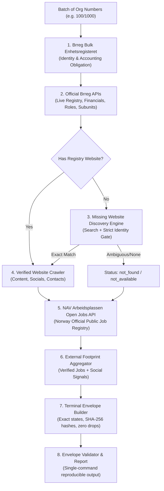

# Signalpost Hackathon — Winning Agent Implementation Plan

## Goal Description
Build and submit an autonomous Norwegian company research agent for the [Signalpost challenge on Builderr.ai](https://builderr.ai/challenges/signalpost) to win 1st place ($2,500 prize pool) and become the **first ever qualified entry** (threshold: 65/100).

Currently:
- 37 entries submitted, 28 assessed, **0 qualified**.
- #1 leader Nikita has **60.80 / 100** (Recall: 13.82/50, Evidence: 26.98/30, Synthesis: 12.00/12, UX: 8.00/8).
- **Root cause of competitors' stall:** Competitors only run the starter kit baseline against Brønnøysundregistrene (Brreg). They have zero job discovery, zero missing-website discovery, and zero external footprint in their batch runners.
- **Winning strategy:** Boost **Recall & Coverage** from ~13/50 to 30+/50 while preserving near-perfect **Evidence & Precision** (>27/30), pushing total score to **77–82 / 100**.

---

## User Review Required

> [!IMPORTANT]
> **External API Keys & Credentials**:
> The primary data sources (Brønnøysundregistrene Enhetsregisteret, Regnskapsregisteret, Roller, Underenheter, and NAV Arbeidsplassen Job Search API) are **100% free, public, and open Norwegian government endpoints** requiring no paid credentials.
> For missing-website web search fallback, we will implement a dual adapter:
> 1. DuckDuckGo / Norwegian registry search (Zero cost, no API key required).
> 2. Brave Search API (Optional, enabled if `BRAVE_SEARCH_API_KEY` is set).

> [!WARNING]
> **Strict Qualification Rule**:
> Under Builderr's evaluation contract, **zero material wrong-company matches** are permitted. Publishing facts for the wrong company blocks qualification even if recall is high. All discoveries must strictly pass the deterministic `identity.py` gate.

---

## Open Questions

1. **Target Repository**: Should we initialize the repository in `C:\Users\messi\signalpost-agent` or another specific folder?
2. **Submitter Details**: What **Agent Name** (e.g., `Signalpost-Apex`, `NordicSignal-AI`) and **Contact Email** would you like used in the submission envelope?

---

## Proposed Changes



---

### Component 1: Project Setup & Baseline Tooling
Setup the working directory `C:\Users\messi\signalpost-agent`, sync dependencies with `uv`, and verify local sample replay.

#### [NEW] `pyproject.toml`
Pinned Python 3.12 environment with `httpx`, `pytest`, `beautifulsoup4`, `tqdm`.

#### [NEW] `scripts/setup_environment.py`
Helper to download frozen Brreg snapshot (`brreg-enheter.csv`) and universe fixture (`signalpost-universe.jsonl.gz`).

---

### Component 2: High-Recall External Connectors

#### [NEW] `src/norway_company_agent/jobs.py`
Integration with the Norwegian government's official public jobs API:
- Endpoint: `https://arbeidsplassen.nav.no/stillinger/api/search`
- Query strategy: Search by exact legal company name and municipality.
- Identity validation: Verifies `businessName` against legal name tokens.
- Output mapping: Produces publishable `job_posting` observations with exact URL `https://arbeidsplassen.nav.no/stillinger/stilling/{uuid}`, published date, application deadline, and content SHA-256 hash.
- Mode: `official_api`, Rights: `approved`.

```python
# Example interface
def fetch_company_jobs(profile: dict[str, Any], timeout: float = 10.0) -> tuple[dict[str, Any], list[Any]]:
    """Query NAV Arbeidsplassen for active jobs matching exact legal entity."""
    ...
```

#### [MODIFY] `src/norway_company_agent/discovery.py`
Enhance search discovery to work with zero external dependencies:
- Add a resilient discovery provider supporting DuckDuckGo HTML / public search in addition to Brave Search.
- Maintain existing deterministic gate (`name_in_host` and `org_match` or `all_name_tokens_in_title`).
- Reject directories and social media links.

---

### Component 3: Batch Runner & Pipeline Integration

#### [MODIFY] `src/norway_company_agent/batch.py`
- Register `jobs` and `website_discovery` as core terminal modules.
- Ensure terminal state transitions map cleanly to `complete`, `not_found`, `blocked_robots`, `not_applicable`.
- Enforce invariant: 100% of input companies get exactly one terminal envelope.

#### [MODIFY] `scripts/run_competition_batch.py`
- Update default `--modules` argument to:
  `"registry,accounting_obligation,registry_live,financials,roles,group,locations,website,jobs"`
- Update `enrich(profile)` loop:
  1. Fetch official Brreg modules.
  2. If website is missing, run `discover_company_website()`.
  3. Fetch and gate website content (structured data, social links, careers).
  4. Fetch NAV Arbeidsplassen active job postings.
  5. Assemble external footprint observations.
- Checkpoint every 25 companies, record latencies, requests, and bandwidth.

---

### Component 4: Evaluation & Idempotent Refresh Verification

#### [MODIFY] `src/norway_company_agent/refresh.py`
- Verify that consecutive runs on the same input batch produce zero false changes and preserve earlier evidence.

#### [NEW] `scripts/run_smoke_test.py`
- Automated wrapper to run a clean 100-company smoke test.
- Generates `out/smoke-envelopes.jsonl` and `out/smoke-report.json`.
- Runs `validate_envelopes()` to ensure zero errors.

---

## Verification Plan

### Automated Tests
1. **Unit & Regression Suite**:
   ```bash
   uv run pytest -q
   ```
   Must pass all 100+ tests including identity gates, financial parsing, and envelope contracts.

2. **Saved Replay Contract**:
   ```bash
   python scripts/run_refresh_replay.py --manifest tests/fixtures/refresh-snapshots.json --output out/refresh-demo.json
   ```
   Verify 2 expected changes, 0 false changes, idempotency passed.

3. **100-Company Live Smoke Test**:
   ```bash
   uv run python scripts/run_competition_batch.py \
     --organisations smoke-companies.jsonl \
     --bulk brreg-enheter.csv \
     --profiles-output out/smoke-profiles.jsonl \
     --output out/smoke-envelopes.jsonl \
     --report out/smoke-report.json \
     --run-id smoke-apex-001 \
     --expected-count 100
   ```
   Verify:
   - Exit code: 0
   - `validation.passed`: true
   - `emitted_envelopes`: 100
   - Zero silent drops
   - Discovered jobs and websites verified with SHA-256 hashes.

### Manual Verification
- Review `out/smoke-report.json` to verify request count, latency p50/p95, and cost ($0.00).
- Spot-check 5 random envelopes in `out/smoke-envelopes.jsonl` for exact company attribution.
- Review draft submission email matching Builderr's required format.
